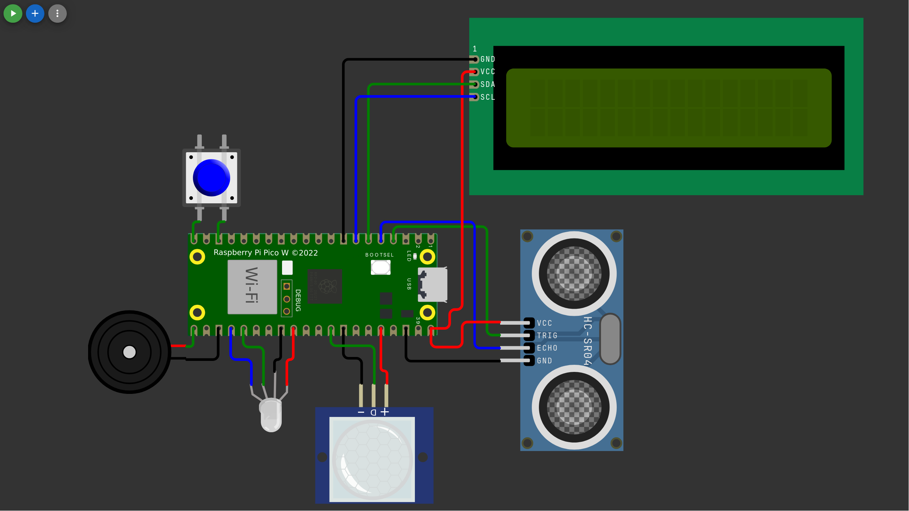

# Sistema de Seguridad IoT

Alarma con Pico W en Wokwi: detecta intrusos con PIR y ultrasónico, se controla desde Adafruit IO o HiveMQ y guarda todo en MariaDB.

Parcial #2. Integrantes: Arles, Gloria, Luis, Juan, Alex.

| | |
|---|---|
| Placa | Raspberry Pi Pico W (Wokwi) |
| Sensores | PIR, HC-SR04, botón |
| Actuadores | LED RGB, buzzer, LCD 16x2 I2C |
| MQTT | HiveMQ (`broker.hivemq.com:1883`) |
| Nube | Adafruit IO |
| BD | MariaDB (XAMPP) |



## Cómo funciona

Si está armada y algo se mueve o se acerca a menos de 100 cm, suena la alarma.

- Estados: `DESARMADO` (azul), `ARMADO` (verde), `ALARMA` (rojo + buzzer)
- Comandos: `armar`, `desarmar`, `silenciar`. Llegan por el botón, HiveMQ o Adafruit IO
- El Pico publica telemetría cada 1 s en HiveMQ y cada 10 s en Adafruit IO
- `gateway/registrador.py` escucha HiveMQ en la PC y guarda todo en MariaDB

Tópicos y payloads en el [contrato](docs/contrato.md).

## Estructura

| Carpeta | Qué tiene |
|---|---|
| `wokwi/` | Código del Pico W y circuito |
| `gateway/` | Registrador MQTT → MariaDB |
| `sql/` | Esquema y consultas |
| `docs/` | Arquitectura, contrato, enunciado y capturas |

## Cómo correrlo

Se levanta en tres partes: la BD, el registrador y la simulación.

### Pico W (Wokwi)

1. Crear un proyecto Pico W MicroPython en Wokwi
2. Subir todos los archivos de `wokwi/`
3. En `secretos.py` poner usuario y key de Adafruit IO
4. En Adafruit IO crear los feeds `movimiento`, `distancia`, `estado` y `comandos`
5. Iniciar la simulación

### Base de datos

1. Iniciar Apache y MySQL en XAMPP
2. En phpMyAdmin importar `sql/schema.sql`
3. Crear el usuario `ds8` con clave `ds8` y permisos sobre `seguridad`

### Registrador

```bash
python -m venv .venv
source .venv/bin/activate
pip install -r requirements.txt
cd gateway
python registrador.py
```

## Probar comandos sin Adafruit

Con `mosquitto` se mandan comandos y se ve todo lo que publica el Pico.

```bash
mosquitto_pub -h broker.hivemq.com -t ds8/security/pico1/commands -m armar
mosquitto_sub -h broker.hivemq.com -t "ds8/security/pico1/#" -v
```

## Docs

- [Arquitectura](docs/arquitectura.md)
- [Contrato](docs/contrato.md)
- [Enunciado](docs/enunciado.md)
