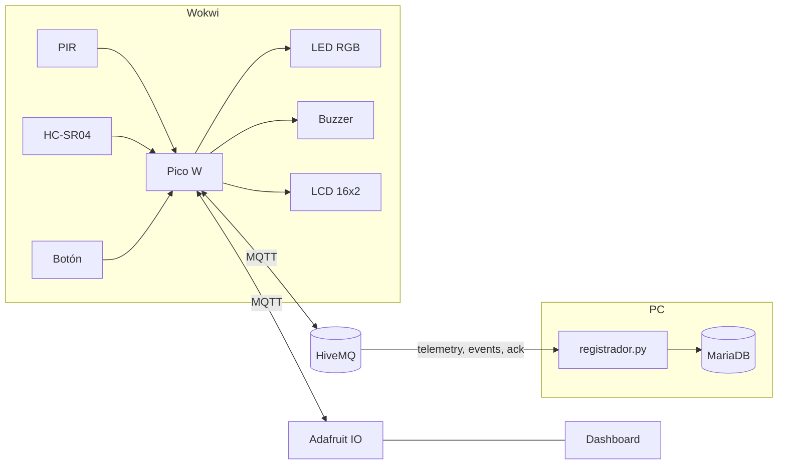
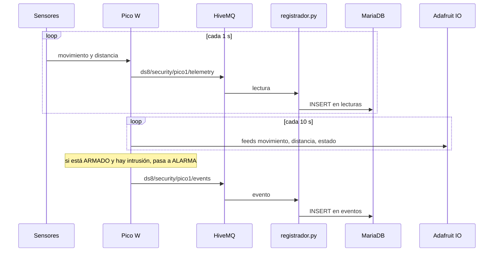
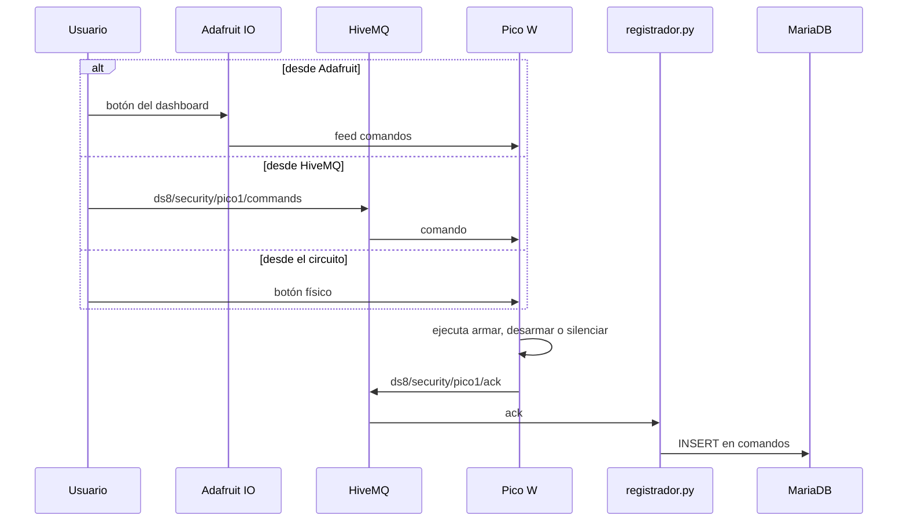
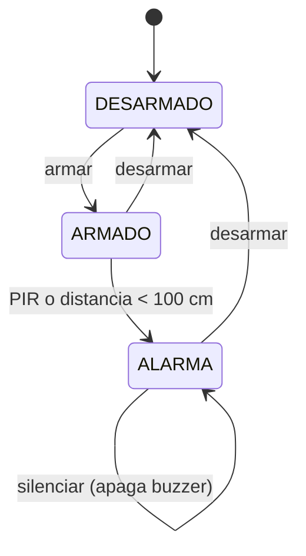

# Arquitectura

El Pico W publica por MQTT a HiveMQ y a Adafruit IO. La PC escucha HiveMQ y guarda en MariaDB. Los comandos llegan desde Adafruit, HiveMQ o el botón.

## Componentes

- **Pico W (Wokwi)**: lee los sensores, maneja la alarma y los actuadores, y habla MQTT con HiveMQ y Adafruit IO
- **HiveMQ**: broker MQTT público, recibe telemetría, eventos y ack, y manda comandos
- **Adafruit IO**: nube con el dashboard en tiempo real y los botones para mandar comandos
- **registrador.py**: corre en la PC, escucha HiveMQ y guarda todo en MariaDB
- **MariaDB (XAMPP)**: base `seguridad` con las tablas `lecturas`, `eventos` y `comandos`

## Diagrama de arquitectura

## Flujo de datos

### Telemetría e intrusión

Cada lectura y cada intrusión termina en MariaDB. Adafruit solo recibe un resumen cada 10 s por su límite de 30 datos/min.

### Comandos

Venga de donde venga, el comando se ejecuta en el Pico y su `ack` se guarda en la tabla `comandos`.

## Estados de la alarma

Solo dispara si está ARMADO. `desarmar` siempre vuelve a DESARMADO.

